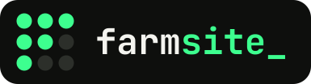
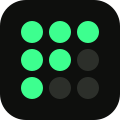
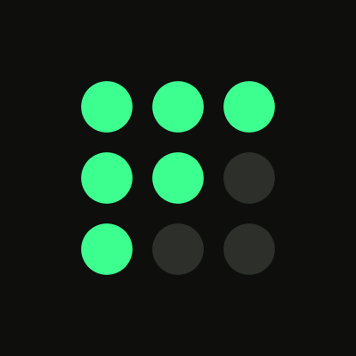
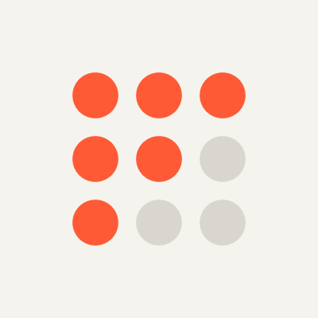

<p align="center"></p>

<p align="center"><b>Сайты, которые вырастают сами.</b><br>Продукт CrowHub Studio.</p>

---

Бренд FarmSite + стартовый автопилот: **issue с лидом → агент исследует бизнес → сайт‑превью на Cloudflare Pages → уведомление в Telegram**.

| | |
|---|---|
| 📕 [`BRAND.md`](BRAND.md) | Брендбук: суть, логотип, цвета, шрифты, motion, голос |
| 🎨 [`tokens/`](tokens) | `tokens.css` и `tokens.json` — подключать в любой проект |
| 🌱 [`logo/`](logo) | SVG: lockup, знак, моно, favicon |
| ✍️ [`prompts/claude-design.md`](prompts/claude-design.md) | Промт для Claude Design — лендинг FarmSite |
| 🤖 [`prompts/site-generator.md`](prompts/site-generator.md) | Системный промт агента, который выращивает клиентские сайты |
| ⚙️ [`automation/`](automation) + [`.github/workflows/grow-site.yml`](.github/workflows/grow-site.yml) | Пайплайн |
| 🗺 [`PLAN.md`](PLAN.md) | План и TODO |
| 🔍 [`docs/drafts-review.md`](docs/drafts-review.md) | Оценка черновиков лендинга |

## Логотип

| Dark | Light | Знак | Анимация |
|---|---|---|---|
|  |  |   |   |

Исходник растра: `farmsite-logo.png`, `farmsite-logo.gif`. Облегчённые GIF — `gif 2/`.

## Запуск автопилота (≈ 10 минут)

1. **Settings → Secrets and variables → Actions → New secret**
   - `ANTHROPIC_API_KEY` *(обязательно)*
   - `CLOUDFLARE_API_TOKEN`, `CLOUDFLARE_ACCOUNT_ID` *(превью‑хостинг)*
   - `TELEGRAM_BOT_TOKEN`, `TELEGRAM_CHAT_ID` *(уведомления)*
2. Метки `lead` и `grown` уже созданы.
3. **Issues → New issue → 🌱 Новый лид** → заполнить → Submit.
4. Через 5–15 минут: сайт в `sites/<дата>-<клиент>/`, превью `https://<дата>-<клиент>.farmsite-previews.pages.dev`, комментарий в issue со стоимостью и временем.

Переменные (Settings → Variables), необязательно: `FARMSITE_MODEL` (по умолчанию `claude-sonnet-5-5`), `FARMSITE_RESEARCH` (`1` — агент ищет бизнес в вебе, `0` — только бриф), `CF_PAGES_PROJECT`.

Локально:
```bash
export ANTHROPIC_API_KEY=...
node automation/generate.mjs examples/lead.example.json
open sites/*/index.html
```
